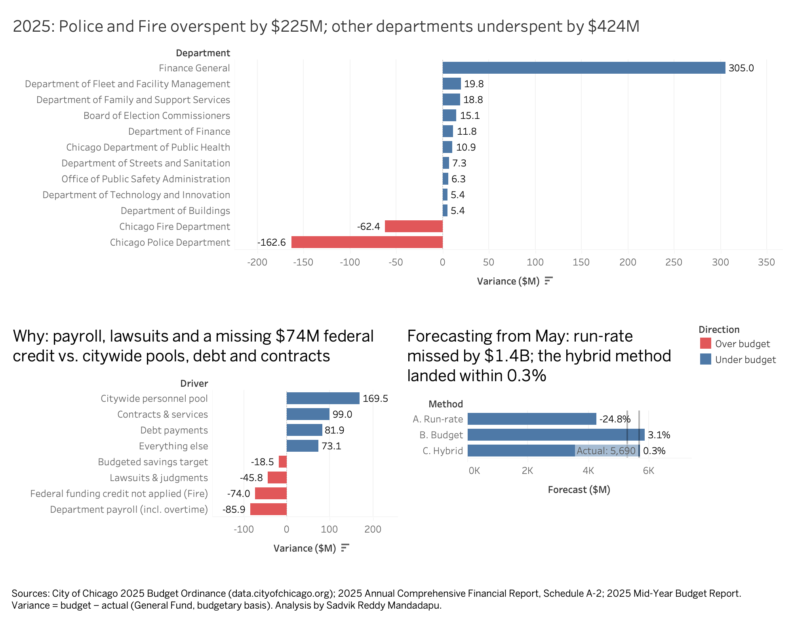

# Chicago 2025 Budget vs Actual

In its 2025 annual financial report, the City of Chicago said its General Fund spent $199.2M less than budgeted and credited "operational efficiencies." I wanted to see what was actually behind that number.

So I rebuilt the City's budget vs actual from its own published data, line by line. I reconciled the two sources to the dollar, broke the variance down by department and by cause, and tested whether the year-end result could have been forecast from the mid-year numbers.



**Written memo:** [memo/budget_vs_actual_memo_2025.pdf](memo/budget_vs_actual_memo_2025.pdf)

---

## Contents

1. [The short version](#the-short-version)
2. [Data sources](#data-sources)
3. [Step 1: Where does the money go?](#step-1-where-does-the-money-go)
4. [Step 2: What changed from 2024?](#step-2-what-changed-from-2024)
5. [Step 3: What is the money spent on?](#step-3-what-is-the-money-spent-on)
6. [Step 4: Who over- and underspent?](#step-4-who-over--and-underspent)
7. [Step 5: Why?](#step-5-why)
8. [Step 6: Could it have been predicted?](#step-6-could-it-have-been-predicted)
9. [Step 7: Dashboard and memo](#step-7-dashboard-and-memo)
10. [Checks I ran](#checks-i-ran)
11. [Limitations and open questions](#limitations-and-open-questions)
12. [Repository layout](#repository-layout)
13. [How to run it](#how-to-run-it)

---

## The short version

- The $199.2M net underspend is two opposite stories added together: **$424.3M under budget** across 30 departments and **$225.1M over budget** in 4.
- **Police ($162.6M over) and Fire ($62.4M over)** make up almost all of the overrun.
- **$305.0M of the underspend is in Finance General**, the citywide account that pays for employee health care, raises, debt and pensions. Most of the "savings" are central pools and lower debt payments, not departments spending less on their operations.
- Police went over mainly on **payroll** ($120.3M over, with only $100M budgeted for overtime) and **lawsuit settlements** ($131.1M paid against $82.6M budgeted).
- Fire's overrun is mostly a **$74.0M federal relief credit** that was in the budget but never showed up in the General Fund actuals. Fire's own payroll came in $18.7M under.
- From May data, a straight **run-rate forecast missed by $1.4B**. A hybrid method got the citywide total within **0.3%**, but still missed by **$722M** department by department.

---

## Data sources

All data is public and published by the City of Chicago.

| Data | Source | Format | What I used it for |
|---|---|---|---|
| 2025 budget | [2025 Budget Ordinance, Appropriations](https://data.cityofchicago.org/api/views/t59y-fr3k/rows.csv?accessType=DOWNLOAD), City Data Portal | CSV | Budget by fund, department and line item |
| 2024 budget | [2024 Budget Ordinance, Appropriations](https://data.cityofchicago.org/api/views/x394-e874/rows.csv?accessType=DOWNLOAD), City Data Portal | CSV | Year-over-year comparison |
| 2025 actual spending | 2025 Annual Comprehensive Financial Report (ACFR), Schedule A-2, Department of Finance | PDF | Audited full-year actuals by department and line |
| Spending through May 31, 2025 | [2025 Mid-Year Budget Report](https://www.chicago.gov/content/dam/city/depts/obm/supp_info/2025Budget/2025%20Mid-Year%20Budget%20Report.pdf), Office of Budget and Management | PDF | Starting point for the year-end forecast |

The budget comes as clean data. The actuals don't: the City only publishes them as tables inside PDF reports. Getting them out was a real part of the work (see Step 4).

All analysis is on the **General Fund, budgetary basis**, in millions of dollars. **Variance = budget − actual**, so a positive number means under budget and a negative number means over budget.

---

## Step 1: Where does the money go?

**Script:** `sql/01_load_and_where_money_goes.sql`

I loaded both budget files into DuckDB, renamed the columns to something usable, and checked the totals before doing anything else. The 2025 file adds up to **$18,842.1M across all funds** and **$5,788.0M in the Corporate Fund**, the City's main operating budget. Both match the City's own published figures, so the data was complete.

Then I ranked departments by their Corporate Fund budget and used window functions (`SUM() OVER ()`) to get each department's share of the total and a running cumulative share.

| Department | 2025 budget ($M) | Share |
|---|---|---|
| Finance General | 2,117.2 | 37% |
| Police | 1,817.9 | 31% |
| Fire | 592.1 | 10% |
| Fleet and Facility Management | 279.3 | 5% |
| Streets and Sanitation | 205.5 | 4% |
| Family and Support Services | 164.8 | 3% |
| 30 other departments | 611.3 | 11% |

**What it shows:** the budget is very concentrated. Three areas take 78% of it. Finance General isn't a real department: it holds citywide costs like pensions (about $760M), employee health care (about $410M) and debt payments (about $145M).

---

## Step 2: What changed from 2024?

**Script:** `sql/02_change_vs_2024.sql`

I summed each year by department and joined them with a `FULL OUTER JOIN`, so a department that existed in only one year would still show up. All 36 department names matched between the two years.

| Department | 2024 ($M) | 2025 ($M) | Change |
|---|---|---|---|
| Police | 1,739.5 | 1,817.9 | +78.4 (+4.5%) |
| Fire | 663.8 | 592.1 | −71.7 (−10.8%) |
| Family and Support Services | 120.3 | 164.8 | +44.5 (+37%) |
| Finance General | 2,088.9 | 2,117.2 | +28.3 (+1.4%) |

**What it shows:** the 10.8% "cut" to Fire looked alarming, so I drilled down to Fire's line items. Almost all of it is one **negative line of −$74.0M called "American Rescue Plan Revenue Replacement"**: federal relief money set to cover part of Fire's costs. It's a funding shift, not a real cut. That same line turned out to matter again in Step 5.

---

## Step 3: What is the money spent on?

**Script:** `sql/03_what_is_it_spent_on.sql`

The budget has about 180 Corporate Fund line items. I grouped them into a few expense categories with a `CASE WHEN` mapping based on the City's account code ranges (0000–0099 personnel, 0100–0299 contracts, and so on) plus keywords for pensions, overtime and health care. The order of the rules matters, because `CASE` uses the first match, so the specific rules come before the general ones.

| Category | 2025 ($M) | Share | Change vs 2024 ($M) |
|---|---|---|---|
| Salaries and other pay | 2,885.8 | 50% | +144.6 |
| Pensions | 943.4 | 16% | +141.6 |
| Contracts and services | 598.0 | 10% | +10.1 |
| Health care and benefits | 544.5 | 9% | +27.5 |
| City programs | 339.0 | 6% | −110.7 |
| Debt and legal judgments | 283.6 | 5% | −37.7 |
| Overtime | 164.1 | 3% | −1.6 |

**A mistake I caught:** my first version put "Emergency Medical Transportation" ($127.6M) under health care and benefits because its name contains "medical." It's an ambulance service the City pays for, not an employee benefit. I only found it by reviewing the largest lines in each category, so the script ends with that review query. The "Other" bucket ended up holding just $17.3M (0.3%).

**What it shows:**
- About 78% of the Corporate Fund is people costs: salaries, overtime, health care and pensions.
- Pensions grew almost as much as all salaries combined (+$142M vs +$145M), and that growth can't be cut in the short term.
- City programs fell $111M mainly because a one-time $150M "New Arrivals Services" line from 2024 isn't in the 2025 budget.

---

## Step 4: Who over- and underspent?

**Scripts:** `python/extract_acfr_actuals.py`, `sql/04_budget_vs_actual.sql`

### Getting the actuals out of the PDF

The audited actuals are in Schedule A-2 of the ACFR, a multi-page table of budget vs actual for every General Fund department and line. I wrote a Python script with `pdfplumber` that:

- finds the schedule in the PDF,
- reads each department header (which includes the department number),
- reads each line's original budget, final budget and actual, including descriptions that wrap onto several lines,
- adds up each department's lines and checks them against the department totals printed in the report.

That last check caught a bug. Two line codes contain letters (`929A` Casino Community Impact and `929C` Accessibility Programming), and my first pattern only accepted digits. Those two missing lines were exactly the $2.5M budget gap. After the fix, **all 395 lines match the ACFR to the dollar: $5,889,083,936 budget and $5,689,918,885 actual.**

### Reconciling the two sources

The ACFR's General Fund budget ($5,889.1M) was $101.1M bigger than the Corporate Fund in the budget file ($5,788.0M). Working through it department by department, I found two reasons:

- The ACFR's General Fund also includes the **Garbage Collection Fund** ($75.8M) and the **Foreign Fire Insurance Tax Fund** ($25.3M).
- It reports two small departments under a parent agency: Business Affairs (70) under Buildings (67), and the Community Commission (62) under COPA (60).

With those rules, every department in the budget file matches the ACFR exactly. The SQL script runs this reconciliation first, before any variance numbers.

### Results

I flagged a variance as material if it was at least $5M, or at least 5% of budget and at least $1M (so a tiny office with a $40K gap doesn't get flagged).

| | $M |
|---|---|
| Final budget | 5,889.1 |
| Actual | 5,689.9 |
| **Net under budget** | **199.2** |
| Total under budget (30 departments) | 424.3 |
| Total over budget (4 departments) | 225.1 |

| Department | Variance ($M) | % of budget |
|---|---|---|
| Finance General | +305.0 | |
| Fleet and Facility Management | +19.8 | |
| Family and Support Services | +18.8 | |
| Board of Election Commissioners | +15.1 | |
| Department of Finance | +11.8 | |
| Public Health | +10.9 | |
| Fire | **−62.4** | −10.5% |
| Police | **−162.6** | −8.9% |

The Police figure matches what local news reported from the same ACFR, which was a useful independent check.

---

## Step 5: Why?

**Script:** `sql/05_variance_drivers.sql`

I drilled from department totals into the ACFR lines for the three biggest stories (Police, Fire, Finance General). Then I grouped every one of the 395 lines by cause, so the whole $199.2M fits in one short table:

| Driver | Variance ($M) |
|---|---|
| Citywide personnel pool (Finance General) | +169.5 |
| Contracts and services | +99.0 |
| Debt payments | +81.8 |
| Everything else | +73.1 |
| Budgeted savings target not met | −18.5 |
| Lawsuits and judgments | −45.8 |
| Federal funding credit not applied (Fire) | −74.0 |
| Department payroll, incl. overtime | −85.9 |
| **Net** | **+199.2** |

**Police, $162.6M over:**
- Payroll was $120.3M over. The budget set aside $100M for police overtime. WTTW reported that to stay within its 2026 overtime budget, CPD would have to cut overtime about 30% from its 2025 level, which puts 2025 police overtime around $286M. Overtime is very likely the main driver.
- Lawsuit settlements were $48.5M over: $131.1M paid against $82.6M budgeted.

**Fire, $62.4M over, but mostly on paper:** the budget assumed a $74.0M credit from federal relief money, and the General Fund actuals show $0 for it. Fire's actual payroll was $18.7M under budget, so its operations weren't overspending.

**Finance General, $305.0M under:** the biggest piece is $169.5M in personnel. That pool includes $162.9M for scheduled wage adjustments (raises expected from union contracts). My read is that the raises were paid through department payrolls like Police while the budget for them stayed in Finance General, which would make Police look over and Finance General look under for the same dollars. I haven't been able to confirm this. Debt payments were another $81.8M under.

**Answer to the original question:** most of the $199M is not operational savings. It's money budgeted in one place and spent in another, a funding credit that didn't show up, and lower debt payments, partly offset by real overruns in police overtime and lawsuits.

---

## Step 6: Could it have been predicted?

**Files:** `python/extract_midyear_ytd.py`, `python/build_forecast_xlsx.py`, `excel/06_year_end_forecast.xlsx`

The Mid-Year Budget Report has spending through May 31, 2025 for every department and fund. I extracted that table with Python (it matches the report's Corporate Fund total of $5,788.0M) and built an Excel model that forecasts year-end spending three ways, then compares each forecast with the audited actuals.

- **A. Run-rate:** spending so far ÷ 5 months × 12.
- **B. Budget:** assume every department spends exactly its budget.
- **C. Hybrid:** run-rate for departments on pace (at least 30% spent by May), budget for departments behind pace, and budget for Finance General, whose costs are paid in lumps.

| Method | Forecast ($M) | Error vs actual ($M) | Error % | Sum of department errors ($M) |
|---|---|---|---|---|
| A. Run-rate | 4,281.5 | −1,408.4 | −24.8% | 1,420.7 |
| B. Budget | 5,863.8 | +173.9 | +3.1% | 624.1 |
| C. Hybrid | 5,707.7 | +17.8 | +0.3% | 721.8 |

The model is formula-driven (368 formulas). The months elapsed, the "on pace" threshold and the Finance General rule are input cells on the Assumptions sheet, so you can test other assumptions.

**What it shows:**
- The run-rate fails because only 30% of the budget had been spent by the end of May, when 42% of the year had passed. Finance General was only 20% spent in May and finished at 87%. Pensions, debt and health claims are paid in large chunks, and invoices arrive late.
- The hybrid's total is close, but partly by luck: its department-level misses add up to $722M, and the Police and Fire overruns cancel out Finance General's underspend.
- Police was spending right on pace in May (40% of budget) and still finished $162.6M over. No method based on spending pace would have caught that. Overtime and lawsuits need to be tracked directly.

---

## Step 7: Dashboard and memo

**Dashboard** (`dashboard/`): a Tableau dashboard with three views, built from the CSVs in the same folder:

1. Who over- and underspent: departments with a variance of $5M or more, overruns in red.
2. Why: the variance drivers from Step 5.
3. Forecast: the three methods against the actual, with a reference line at $5,689.9M.

Each chart title states its finding, and the sources are listed at the bottom.

**Memo** (`memo/`): a five-page write-up with the summary, results by department, drivers, forecast accuracy, recommendations for 2026, and the data and method notes.

---

## Checks I ran

| Check | Result |
|---|---|
| 2025 budget file vs City totals | All funds $18,842.1M, Corporate Fund $5,788.0M. Both match. |
| ACFR line items vs ACFR department totals | All departments match after fixing the letter-code bug |
| ACFR extract vs ACFR grand totals | Matches to the dollar |
| Budget file vs ACFR, by department | All 34 match after the fund and department rules |
| Expense category mapping | Reviewed the largest lines per category; fixed one misclassification |
| Mid-year extract vs report total | Corporate Fund matches; all funds differ by $4 from rounding in the report |
| Police overrun vs public reporting | $162.6M vs $162.5M reported |
| Driver table vs net variance | Adds to $199.2M |

---

## Limitations and open questions

- The ACFR gives actuals by line group (personnel, contracts, and so on), not by individual account, so I can't split Police payroll into regular pay, overtime and raises from the City's data alone.
- The police overtime figure comes from news reporting, and it may include overtime paid from funds outside the General Fund.
- The Mid-Year report excludes encumbrances, and the ACFR's Foreign Fire Insurance Tax Fund (about $0.4M of actual spending) isn't in the mid-year data.

Still open:
- Was the $74.0M Fire credit charged to a federal grant fund instead of the General Fund?
- Was the $81.8M debt underspend from refinancing, or just timing?
- How much of the $120.3M Police payroll overrun is overtime, and how much is raises paid from the central pool?

---

## Repository layout

```
chicago-budget-vs-actual-2025/
├── README.md
├── requirements.txt
├── data/
│   ├── budget_2025.csv          2025 Budget Ordinance (City Data Portal)
│   ├── budget_2024.csv          2024 Budget Ordinance (City Data Portal)
│   ├── actuals_2025.csv         Extracted from the 2025 ACFR, Schedule A-2
│   └── midyear_ytd_2025.csv     Extracted from the 2025 Mid-Year Budget Report
├── sql/
│   ├── 01_load_and_where_money_goes.sql
│   ├── 02_change_vs_2024.sql
│   ├── 03_what_is_it_spent_on.sql
│   ├── 04_budget_vs_actual.sql
│   └── 05_variance_drivers.sql
├── python/
│   ├── extract_acfr_actuals.py
│   ├── extract_midyear_ytd.py
│   └── build_forecast_xlsx.py
├── excel/
│   └── 06_year_end_forecast.xlsx
├── dashboard/
│   ├── Chicago 2025 Budget vs Actual.twb
│   ├── dashboard.png
│   ├── dept_variance_2025.csv
│   ├── variance_drivers_2025.csv
│   └── forecast_accuracy_2025.csv
└── memo/
    └── budget_vs_actual_memo_2025.pdf
```

The two source PDFs aren't included because of their size. Download them from the links in [Data sources](#data-sources) if you want to rerun the extraction.

---

## How to run it

**SQL (Steps 1–5).** Open the scripts in DBeaver or any DuckDB client. In the `read_csv` lines of scripts 01 and 04, replace `/path/to/chicago-budget-vs-actual-2025/data/` with the path to your `data` folder. Run the scripts in order, 01 through 05. Script 04 starts with the reconciliation check, which should return 5889.1, 5889.1 and 0 mismatching departments.

**Python (only needed to re-extract the PDFs).** Save the ACFR as `data/acfr_2025.pdf` and the Mid-Year report as `data/midyear_2025.pdf`, then run from the repository folder:

```
pip install -r requirements.txt
python python/extract_acfr_actuals.py data/acfr_2025.pdf data/actuals_2025.csv
python python/extract_midyear_ytd.py data/midyear_2025.pdf data/midyear_ytd_2025.csv
python python/build_forecast_xlsx.py
```

Each extraction script prints its totals next to the report's totals so you can confirm they match.

**Excel (Step 6).** Open `excel/06_year_end_forecast.xlsx`. The Forecast sheet has the department-level model; the yellow cells on the Assumptions sheet drive it.

**Tableau (Step 7).** Open `dashboard/Chicago 2025 Budget vs Actual.twb`. If Tableau asks for the data, point it to the three CSVs in `dashboard/`.

---

## Tools

SQL (DuckDB in DBeaver), Python (pdfplumber, pandas, openpyxl), Excel, Tableau.

Sadvik Reddy Mandadapu
